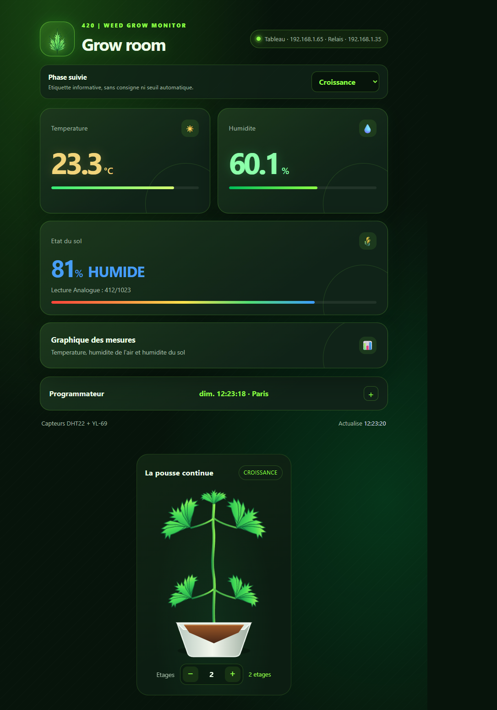
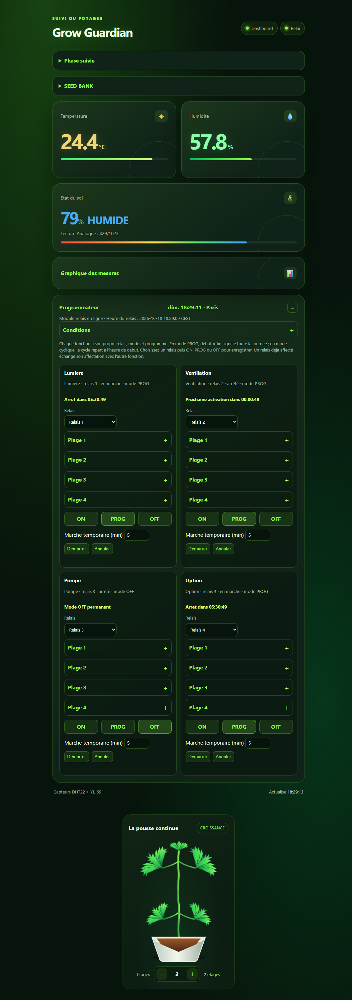
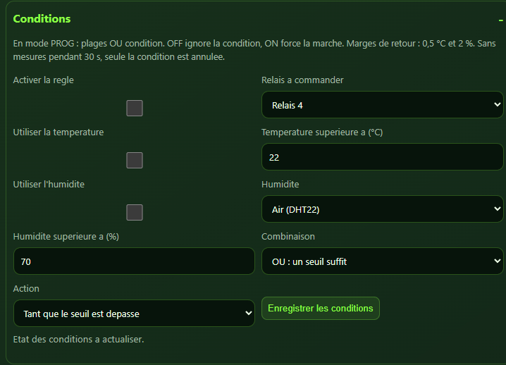
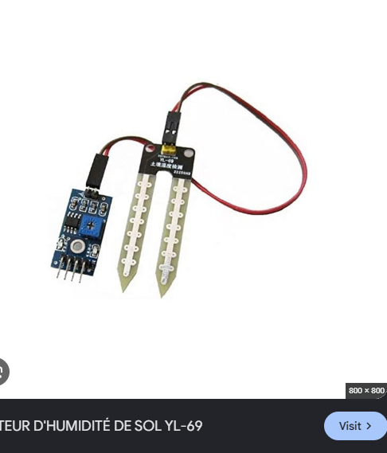
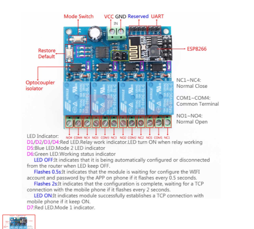

# Grow Guardian

Tableau de bord ESP8266 OLED et programmateur Wi-Fi autonome a quatre relais.

## Apercu du tableau de bord

Temperature, humidite de l'air, humidite du sol, graphiques et programmateur
repliable des quatre relais.

### Programmateur hebdomadaire

Chaque fonction (lumiere, ventilation, pompe et option) dispose de quatre
plages independantes, presentees sous forme de cartes depliables/repliables.
Chaque plage propose ses jours de la semaine, ses horaires et un mode continu
ou cyclique. L'heure du relais reste visible dans l'en-tete.

- Les plages se cumulent : un chevauchement ne provoque pas de faux arret.
- Une plage nocturne appartient au jour de son debut ; debut = fin signifie 24 h.
- Les comptes a rebours annoncent la prochaine activation ou le prochain arret.
- Une marche temporaire peut forcer une sortie pendant 1 a 1440 minutes,
  puis reprendre le mode ON/OFF/PROG enregistre.
- Apres modification des plages, cliquer ON, PROG ou OFF pour enregistrer.
  Les brouillons et l'ouverture des cartes sont conserves pendant l'actualisation.

### Conditions sur la temperature et l'humidite

Une carte **Conditions** permet de choisir le relais physique a commander,
un seuil de temperature et/ou d'humidite (air DHT22 ou sol YL-69).
Les seuils peuvent etre combines avec **ET** ou **OU**.

Deux actions sont possibles : maintenir la marche tant que le seuil est
depasse, ou lancer une duree fixe lors du franchissement. Une marge de retour
de 0,5 degre et 2 points d'humidite evite les oscillations. En mode minuteur,
un depassement permanent ne relance pas la duree : un retour normal puis un
nouveau franchissement sont necessaires.

La fonction affectee au relais cible doit etre en **PROG** :
les plages **OU** la condition peuvent demander la marche. OFF ignore la
condition ; ON force la marche. Enregistrer les conditions ne change pas le mode.
Les marches temporaires manuelles restent independantes.

Le tableau transmet automatiquement les mesures au relais, meme sans navigateur
ouvert. Apres 30 secondes sans mesure recente, seule la demande conditionnelle
est annulee ; les plages continuent. Un defaut explicite sur un capteur requis
annule cette demande immediatement. Les valeurs du sol sont relatives a la
calibration, pas une teneur en eau absolue.

### Reprise apres coupure de courant

Les programmes, affectations et modes sont conserves en EEPROM. Le dernier
etat commande et les echeances temporaires sont sauvegardes dans LittleFS.
Au redemarrage, les sorties sont restaurees, puis recalees sur les horaires
reels des que NTP fournit l'heure de Paris. Les commandes d'etat sont renvoyees
toutes les cinq secondes pour resynchroniser le controleur physique des relais,
qui ne fournit pas d'accuse de reception.

Les marches temporaires manuelles gardent leur heure de fin initiale :
la duree de la panne est comptee. Un minuteur de condition ne reprend qu'avec
une heure et des mesures valides, sans depasser sa fin initiale. Une condition
ancienne ne suffit pas, a elle seule, a restaurer une marche sans nouvelles
mesures ; sans mesures pendant les 30 premieres secondes, sa reprise est annulee.

**Attention : la politique de restauration du dernier etat peut remettre une
pompe en marche avant synchronisation, meme si son horaire est termine.
Sans heure synchronisee, cet etat peut rester actif.** Une horloge secourue
par pile serait necessaire pour connaitre l'heure sans reseau apres coupure.
Les etats affiches sont des commandes, pas une mesure des contacts physiques.

### A propos de ces captures

Captures de l'interface HTML en service, mises a jour le 18 octobre 2026.
Les mesures, heures, affectations et reglages visibles sont des exemples de
l'installation, pas des consignes universelles.

**Les captures et les sections ci-dessus decrivent la version installee sur
les appareils. Les sources publiees dans ce depot n'ont pas encore ete
synchronisees avec les evolutions hebdomadaires, conditions et reprise apres
coupure.** Cette mise a jour concerne la documentation et les images uniquement.

## Materiel en images

### Capteur d'humidite du sol YL-69

Sonde resistive et module de lecture, utilises pour suivre l'humidite du sol.

### Module Wi-Fi ESP8266 / ESP-01 a quatre relais

Carte utilisee pour commander la lumiere, la ventilation, la pompe et une sortie optionnelle.

Les annotations de cette capture concernent le firmware d'origine du module.
Avec Grow Guardian, utiliser la configuration et les commandes decrites ci-dessous.
Verifier la tension d'alimentation indiquee sur votre propre carte.

## Firmwares

- `ESP8266_OLED_Hello_modif_OTA/` : tableau de bord, OLED, DHT22, sonde de sol
  YL-69, historiques, arrosages, min/max et mises a jour ArduinoOTA.
  Carte Arduino : NodeMCU 1.0 (ESP-12E Module).
- `ESP8266_4Relay/` : ESP-01 avec controleur serie de quatre relais,
  protocole UART a 115200 bauds. Carte Arduino : Generic ESP8266 Module, flash 1 Mo.
  Ce firmware relais ne dispose pas d'OTA.

## Installation

Installer le support ESP8266 3.1.2 dans Arduino IDE, puis les bibliotheques
Adafruit GFX Library, Adafruit SSD1306 et DHT sensor library avec leurs dependances.
Les bibliotheques Wi-Fi, HTTP, mDNS, LittleFS, EEPROM et ArduinoOTA sont fournies
par le support ESP8266.

Dans chaque dossier de sketch, copier `secrets.example.h` vers `secrets.h`
et renseigner les identifiants du Wi-Fi. Choisir aussi un mot de passe OTA fort
pour le tableau de bord. Ne jamais publier `secrets.h` : ce fichier est ignore
par Git. Ouvrir le fichier `.ino` du dossier correspondant dans Arduino IDE.

Effectuer le premier televersement par USB. Les mises a jour suivantes du
tableau de bord peuvent utiliser son port reseau ArduinoOTA, annonce sous
`grow-dashboard-ota`. Toujours conserver la fonctionnalite OTA dans le firmware
envoye si les mises a jour sans cable doivent rester disponibles.

## Fonctionnement des sources actuellement publiees

Le tableau de bord decouvre `grow-relay` par mDNS sur le reseau local et
transmet les commandes aux relais. Lumiere, ventilation, pompe et option
disposent chacune d'une affectation, d'un mode ON/PROG/OFF et d'un programme.
Une nouvelle affectation echange les deux relais si le canal est deja utilise.

En PROG : plage continue ou cycles avec duree et intervalle en minutes
(intervalle de debut a debut). Debut = fin signifie 24 heures.
Les cycles repartent a l'heure de debut chaque jour ; une marche est coupee
a la fin de la plage. Les programmes sont sauvegardes en EEPROM et executes
sur le module relais meme sans tableau de bord.

L'heure du relais est synchronisee par NTP avec le fuseau Europe/Paris
(regles CET/CEST). Sans synchronisation apres demarrage, PROG garde les
sorties eteintes. L'API `/api/status` expose `timestamp` et `localTime`
pour verifier l'heure effective.

Le tableau de bord utilise D4 pour le DHT22, A0 pour le sol et GPIO5/GPIO4
pour SDA/SCL de l'OLED. Adapter les references de calibration du sol au materiel.
Les historiques, arrosages et records du tableau de bord sont stockes dans LittleFS.

## Pistes d'amelioration

- Resumer chaque plage repliee : jours, horaires, type et etat actif.
- Ajouter un bouton Enregistrer separe du choix ON/PROG/OFF.
- Exporter et restaurer les programmes dans un fichier de sauvegarde.
- Afficher une vue hebdomadaire et permettre de dupliquer une plage.
- Journaliser les commandes, declenchements conditionnels et redemarrages.
- Ajouter des notifications et une limite de marche maximale pour la pompe.
- Ajouter une horloge RTC secourue pour fonctionner a l'heure sans Internet.
- Proteger l'acces distant par une solution authentifiee, sans exposer HTTP/OTA.

## Securite

Le tableau de bord et l'API relais sont en HTTP sans authentification :
ne pas les exposer directement a Internet. Utiliser un reseau de confiance
et un acces distant securise. Ne pas rediriger le port OTA vers Internet.
ArduinoOTA avec mot de passe n'est pas une liaison chiffree.

Tester les sorties avec les LED ou une charge basse tension adaptee.
Le raccordement au secteur exige du materiel approprie et une installation
realisee par une personne qualifiee.
