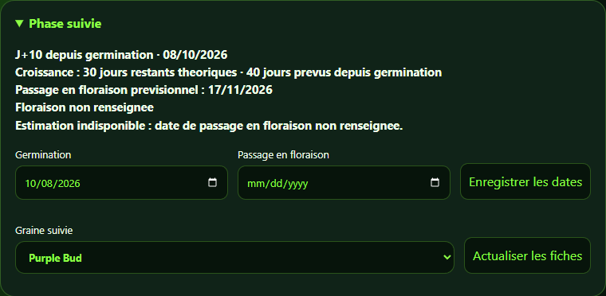
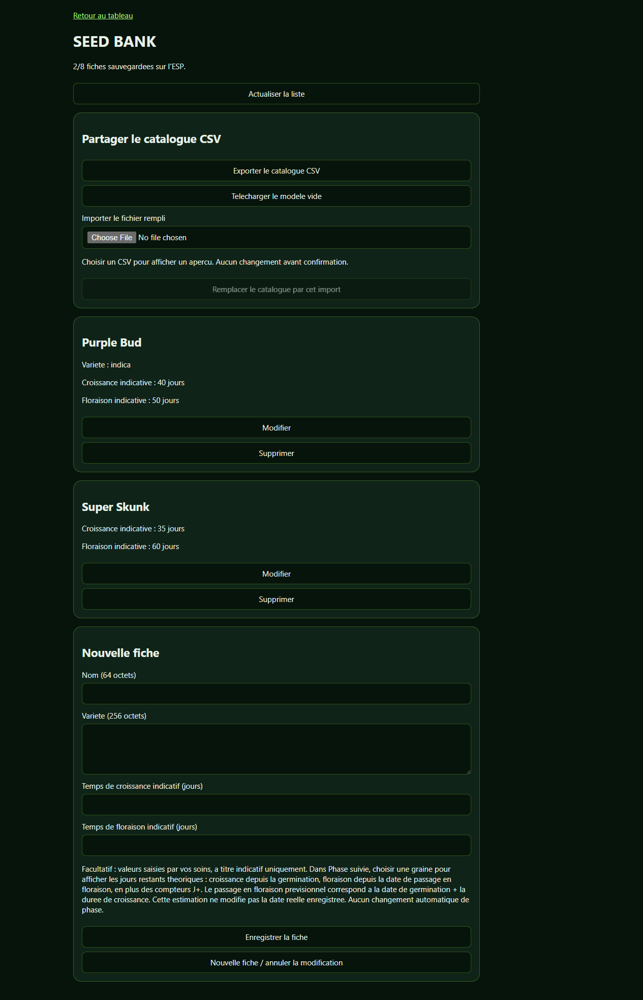
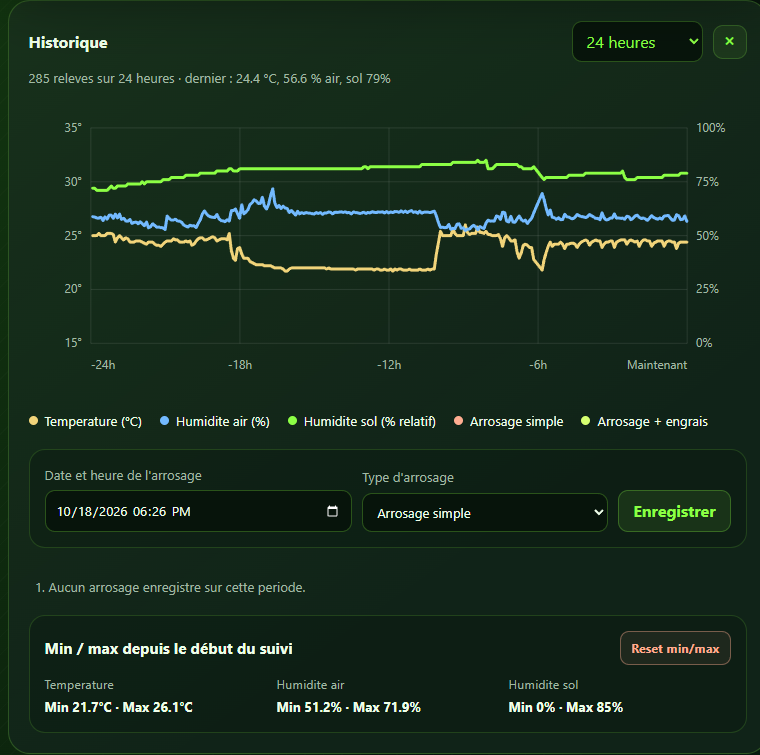
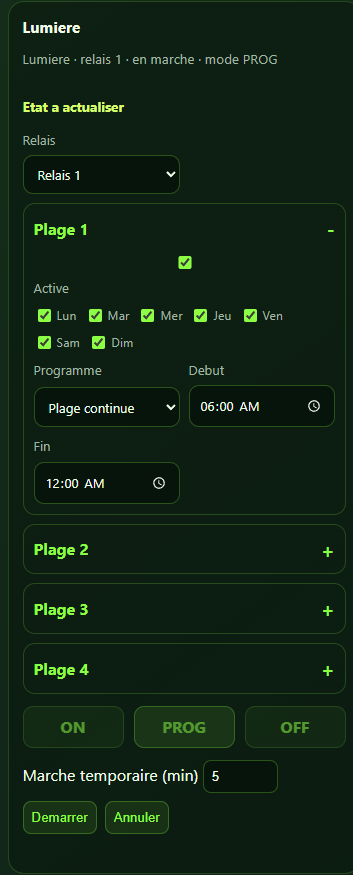

# Grow Guardian

Systeme de suivi et de commande sur reseau local, compose d'un tableau de bord
ESP8266 avec ecran OLED et d'un programmateur autonome ESP8266 a quatre relais.
L'interface web est en francais, adaptee aux ordinateurs et aux mobiles.

**Sources et captures actualisees le 18 octobre 2026.** Ce depot contient les
fonctions decrites ci-dessous : programmateur v3, conditions, reprise apres
coupure, suivi des dates, SEED BANK et previsions informatives.
Les valeurs visibles dans les captures proviennent de l'installation de
demonstration : elles ne constituent pas des recommandations de culture.

## Sommaire

- [Vue d'ensemble](#vue-densemble)
- [Mesures et voyants de connexion](#mesures-et-voyants-de-connexion)
- [Phase suivie et dates previsionnelles](#phase-suivie-et-dates-previsionnelles)
- [SEED BANK et catalogue CSV](#seed-bank-et-catalogue-csv)
- [Graphiques, arrosages et min/max](#graphiques-arrosages-et-minmax)
- [Programmateur a quatre relais](#programmateur-a-quatre-relais)
- [Conditions sur les capteurs](#conditions-sur-les-capteurs)
- [Reprise apres coupure](#reprise-apres-coupure)
- [Ecran OLED et boutons](#ecran-oled-et-boutons)
- [Materiel et branchements](#materiel-et-branchements)
- [Installation et mises a jour](#installation-et-mises-a-jour)
- [API et stockage](#api-et-stockage)
- [Tests](#tests)
- [Limites et precautions](#limites-et-precautions)

## Vue d'ensemble


```text
DHT22 + sonde de sol + OLED
             |
     ESP8266 Dashboard <--- navigateur sur le Wi-Fi local
             |
       HTTP + decouverte mDNS
             |
     ESP8266 Relai (programmateur autonome)
             |
       UART 115200 bauds
             |
     Controleur physique des quatre relais
```

| Element | Fonctions |
| --- | --- |
| Dashboard | Mesures, OLED, interface web, historiques, arrosages, records, dates, catalogue et mises a jour OTA |
| Relai | Execution autonome des plages, modes forces, conditions, temporisations et reprise apres coupure |
| Navigateur | Affichage et edition des reglages ; inutile pour executer les programmes deja enregistres |

Le Dashboard decouvre le module `grow-relay` par mDNS. Il transmet les mesures
au relais environ toutes les cinq secondes, meme sans navigateur ouvert.
Les reglages du programmateur sont executes sur le relais, pas sur le PC.

## Mesures et voyants de connexion

- Temperature et humidite de l'air mesurees par le DHT22.
- Humidite relative du sol issue de l'entree analogique A0, avec pourcentage,
  barre coloree, etat du sol et valeur brute.
- Actualisation du tableau toutes les deux secondes ; etat des relais toutes
  les cinq secondes, avec horloge et comptes a rebours actualises chaque seconde.
- Deux voyants independants **Dashboard** et **Relai** : vert lorsque le dernier
  echange indique une connexion active, gris sinon. L'etat est aussi accessible
  dans le libelle et l'infobulle ; aucune adresse IP n'est affichee dans l'interface.
- Alerte visuelle lors du passage d'un etat connu du sol vers **Sec**.
- Les erreurs de lecture, de reseau et de stockage sont signalees explicitement.

Les cartes **Phase suivie**, **SEED BANK** et **Programmateur** sont repliables.
Les titres utilisent le meme vert. Les cartes de mesure ouvrent leur historique.
L'animation du plant propose de 1 a 8 etages, memorises dans le navigateur ;
elle est decorative et ne mesure pas la croissance reelle.

## Phase suivie et dates previsionnelles



La carte est fermee par defaut. Cliquer sur **Phase suivie** pour afficher :

1. La date de germination, obligatoire, et la date reelle de passage en floraison,
   facultative, puis **Enregistrer les dates**.
2. Les compteurs **J+ depuis germination** et **J+ depuis floraison**.
3. Le choix **Graine suivie**, parmi les fiches SEED BANK.
4. Les jours restants theoriques de croissance et de floraison.
5. La date previsionnelle du passage en floraison.

Les dates sont sauvegardees dans LittleFS sur l'ESP et partagees entre les
navigateurs. Le choix de la graine est memorise uniquement dans le navigateur
utilise. **Actualiser les fiches** recharge les noms et les durees apres edition
du catalogue.

| Affichage | Calcul |
| --- | --- |
| J+ germination | Jours calendaires ecoules depuis la germination |
| J+ floraison | Jours calendaires ecoules depuis le passage reel en floraison |
| Croissance restante | Maximum de 0 et (duree de croissance de la fiche - J+ germination) |
| Floraison restante | Maximum de 0 et (duree de floraison de la fiche - J+ floraison) |
| Passage en floraison previsionnel | Date de germination + duree de croissance de la fiche |

**Exemple de la capture :** germination le 08/10/2026, croissance indicative de
40 jours et floraison indicative de 50 jours. Au 18/10/2026 : **J+10**,
**30 jours de croissance restants theoriques** et passage previsionnel au
**17/11/2026**. Les 50 jours ne servent pas a determiner le debut de floraison :
ils sont decomptes depuis la date reelle lorsqu'elle est renseignee.

Le jour de depart est J+0. Les compteurs suivent le calendrier de Paris,
y compris les changements ete/hiver. Sans heure synchronisee, le compteur
est indisponible ; une prevision basee sur deux valeurs fixes reste calculable.
Les dates futures, durees absentes, erreurs de stockage ou fiches non chargees
ont des messages dedies. Une duree de 0 reste distincte d'une valeur vide.

La floraison ne peut pas preceder la germination. Les dates saisissables vont
de 1970 a 2099. Une prevision **ne renseigne jamais la date reelle**, ne change
aucune phase et ne commande aucun relais. Le selecteur manuel
Croissance/Floraison a ete retire.

## SEED BANK et catalogue CSV



La carte du Dashboard ouvre `/seed-bank`, catalogue personnel de **huit fiches
maximum**. Chaque fiche comporte :

- un nom, obligatoire, limite a 64 octets UTF-8 ;
- une variete / description, limitee a 256 octets UTF-8 ;
- un temps de croissance indicatif ;
- un temps de floraison indicatif.

Les durees sont facultatives : entier de 0 a 9999 jours, ou champ vide.
Les fiches peuvent etre ajoutees, modifiees et supprimees avec confirmation.
Elles sont conservees sur l'ESP ; un echec d'enregistrement conserve le brouillon.
Les donnees affichees sont du texte, pas du HTML execute.

### Exporter et importer

- **Exporter le catalogue CSV** telecharge les fiches.
- **Telecharger le modele vide** fournit les colonnes
  `nom;variete;croissance_jours;floraison_jours`.
- Le [modele CSV](seed-bank-modele.csv) est aussi inclus dans ce depot.
- L'import montre un apercu avant confirmation du remplacement.
- UTF-8, BOM, separateur point-virgule ou virgule, champs entre guillemets et
  textes multilignes sont acceptes. Taille maximale : 16 Ko.
- Les anciens CSV a cinq ou sept colonnes restent lisibles ; notes devient
  variete, les anciens fournisseur/lot/lien sont ignores.
- L'export neutralise les cellules pouvant etre prises pour des formules ;
  l'importeur retire ce prefixe lors du retour.

**L'import remplace toutes les fiches.** Exporter une sauvegarde avant de
continuer. Un CSV contenant seulement l'en-tete vide le catalogue apres
confirmation. Chaque fiche est sauvegardee atomiquement, mais pas l'import
entier : une coupure peut produire un import partiel, signale comme tel.
Actualiser la liste avant de reessayer. Les dates et les programmes restent
independants de cet import.

## Graphiques, arrosages et min/max



- Historique individuel sur 24 heures depuis les cartes temperature, air et sol.
- **Graphique des mesures** : courbes combinees et legende coloree.
- Periodes proposees : 1 h, 3 h, 6 h, 12 h, 24 h, 1 jour et 1 mois.
- Historique court : 288 echantillons, un point toutes les cinq minutes.
- Historique mensuel : 720 echantillons, un point par heure.
- Rechargement des graphiques ouverts toutes les 30 secondes.
- Journal manuel d'arrosages avec date/heure et type : **simple** ou
  **avec engrais**. Jusqu'a 256 evenements conserves et reperes sur le graphique.
- Records min/max temperature, humidite de l'air et sol depuis le debut du suivi.
- **Reset min/max** demande confirmation et ne supprime pas les historiques.

Le journal est declaratif : enregistrer un arrosage n'actionne pas la pompe
et ne prouve pas qu'un arrosage physique a eu lieu.
Les historiques, evenements et records sont sauvegardes dans LittleFS.
Les graphiques ont besoin d'une heure synchronisee et ne recreent pas les
mesures qui n'ont pas ete enregistrees pendant une panne.

## Programmateur a quatre relais


Quatre fonctions : **Lumiere**, **Ventilation**, **Pompe** et **Option**.
Chacune possede une affectation physique de relais 1 a 4 et trois modes :

| Mode | Comportement |
| --- | --- |
| ON | Marche forcee |
| OFF | Arret force |
| PROG | Execution des plages et, si applicable, de la condition |

Choisir un relais deja affecte echange les deux affectations.
Modifier les champs ne suffit pas : cliquer **ON**, **PROG** ou **OFF**
enregistre les reglages et active le mode choisi.
Les brouillons et l'ouverture des plages sont preserves pendant l'actualisation.

### Quatre plages hebdomadaires par fonction



Chaque fonction a quatre plages repliables, soit **16 plages au total** :
activation individuelle, jours de semaine, debut/fin, mode continu ou cyclique.
Une plage active doit avoir au moins un jour selectionne.

- Les jours correspondent au **debut** : dimanche 22:00-02:00 se termine lundi.
- Debut = fin signifie 24 heures a compter du debut.
- En continu, la demande dure toute la plage.
- En cycles, marche pendant une duree, toutes les N minutes, intervalle de debut
  a debut. Duree <= intervalle, de 1 a 1440 minutes.
- Les cycles sont ancres au debut de la plage et coupes a sa fin.
- Les plages se cumulent : un chevauchement ne provoque pas de faux arret.
- Le compte a rebours indique la prochaine transition prevue.
- L'heure du relais reste visible meme quand le programmateur est replie.

### Marche temporaire

Une marche temporaire de **1 a 1440 minutes** force la sortie sans remplacer
le mode sauvegarde. A son terme ou apres annulation, le mode precedent reprend
au point courant du programme. Le compte a rebours annonce la fin du temporaire,
pas forcement un arret si le programme demande encore ON.

Une nouvelle marche exige une heure synchronisee ; son annulation reste possible
sans heure. Enregistrer un programme annule son temporaire. Un echange de relais
annule ceux des deux fonctions concernees.

## Conditions sur les capteurs


Une regle globale, desactivee par defaut, peut viser un relais physique :

- seuil de temperature DHT22 et/ou seuil d'humidite ;
- humidite de l'air DHT22 ou humidite relative du sol ;
- combinaison **ET** / **OU** des seuils coches ;
- declenchement strictement au-dessus du seuil ;
- retour normal a seuil moins 0,5 degre ou moins 2 points d'humidite.

Deux actions : **maintenir tant que le seuil est depasse**, ou **duree fixe au
franchissement** (1 a 1440 minutes). Le minuteur ne se prolonge pas a chaque
mesure haute : il faut revenir a la normale puis franchir a nouveau le seuil.
Ce mode minuteur exige une heure synchronisee.

La fonction affectee au relais cible doit etre en **PROG**. Une plage **OU**
la condition peut demander la marche. ON et OFF restent prioritaires, ainsi
que les marches temporaires manuelles. Enregistrer une condition ne change
pas le mode ; la regle suit le numero physique lors d'un echange d'affectation.

Apres **30 secondes sans mesure recente**, la demande conditionnelle est annulee.
Un defaut explicite sur un capteur requis l'annule immediatement ; les plages
continuent. Les capteurs non selectionnes ne bloquent pas la regle.
Un nouveau franchissement est necessaire pour relancer un minuteur annule.
Enregistrer la regle reinitialise son etat ; elle peut demarrer immediatement
si le seuil est deja depasse et que le relais est en PROG.

## Reprise apres coupure

Les modes, affectations, 16 plages et conditions sont conserves en EEPROM.
LittleFS conserve les derniers etats commandes et les echeances temporaires,
avec verification d'integrite et remplacement atomique.

- ON/OFF sauvegardes reprennent directement.
- Selon la sauvegarde valide, le dernier etat est restaure avant NTP, puis
  PROG se recale sur l'heure reelle de Paris apres synchronisation.
- Sans sauvegarde valide, PROG attend l'heure avec sorties arretees.
- La panne compte dans les temporaires : leur heure de fin initiale est conservee.
- Un minuteur conditionnel ne reprend qu'avec heure et mesures valides, sans
  depasser son ancienne fin. Sans mesures dans les 30 premieres secondes,
  sa reprise conditionnelle est annulee.
- Les commandes d'etat des quatre sorties sont renvoyees toutes les cinq secondes
  pour resynchroniser le controleur serie, sans relancer les temporisations.
- Une sauvegarde corrompue est refusee ; un echec de montage apres initialisation
  ne provoque pas un reformatage automatique.

**Attention : une pompe precedemment active peut redemarrer avant NTP,
meme si sa plage est terminee. Sans heure synchronisee, cet etat peut durer.**
L'ESP n'a pas d'horloge secourue pour connaitre la duree d'une coupure.
Les etats affiches sont des commandes, pas une mesure des contacts physiques :
le controleur UART ne fournit pas d'accuse de reception.

## Ecran OLED et boutons

OLED SSD1306 **128 x 64**, adresse I2C `0x3C`, caracteres taille 2 :

- page air : temperature et humidite ;
- page sol : pourcentage d'humidite du sol ;
- compteur J+ depuis germination en bas des deux pages ;
- aucun affichage d'adresse IP.

Un appui sur **FLASH / GPIO0** alterne les deux pages. Anti-rebond de 40 ms ;
un appui maintenu ne fait pas defiler. La page air revient au redemarrage.
**RESET** redemarre le module, il ne change pas de page.
Ne pas maintenir FLASH pendant le reset ou la mise sous tension : GPIO0
commande aussi l'entree en mode programmation.

## Materiel et branchements

| Composant Dashboard | Broche / configuration |
| --- | --- |
| ESP8266 NodeMCU | NodeMCU 1.0 / ESP-12E |
| DHT22 DATA | D4 |
| Module sol, sortie analogique | A0, respecter la tension admissible de la carte |
| OLED SDA / SCL | GPIO5 / GPIO4 |
| OLED | SSD1306, 128 x 64, `0x3C` |
| Bouton FLASH | GPIO0 |
| Module quatre relais | ESP-01, controleur serie UART 115200 bauds |

Verifier le brochage sur sa propre carte. Les references de calibration par
defaut du sol sont **900 sec / 300 humide**, a adapter dans les sources.
Le pourcentage est relatif, pas une teneur en eau absolue. Les ADC 0/1023 sont
invalides pour les conditions ; une valeur plausible figee ne permet pas de
detecter tous les defauts de sonde.


Les annotations sur la photo du module peuvent concerner son firmware d'origine.
Verifier la tension et le protocole de la carte utilisee.
Confier tout cablage secteur a une personne qualifiee ; ne pas tester des
charges dangereuses sans protections et moyens de coupure adaptes.

## Installation et mises a jour

### Contenu du depot

| Dossier | Usage |
| --- | --- |
| [ESP8266_OLED_Hello_modif_OTA](ESP8266_OLED_Hello_modif_OTA/) | Dashboard avec ArduinoOTA |
| [ESP8266_OLED_Hello](ESP8266_OLED_Hello/) | Variante Dashboard sans ArduinoOTA |
| [ESP8266_4Relay](ESP8266_4Relay/) | Programmateur autonome v3 et modules Scheduler/Condition/Recovery |
| [images](images/) | Captures de l'interface en service et photos du materiel |

Installer le support **ESP8266 3.1.2** dans Arduino IDE et les bibliotheques
**Adafruit GFX Library**, **Adafruit SSD1306**, **DHT sensor library** avec
leurs dependances. Wi-Fi, HTTP, mDNS, LittleFS, EEPROM et OTA viennent du core.

Dans chaque dossier de sketch utilise, copier `secrets.example.h` vers
`secrets.h`, renseigner le Wi-Fi et choisir un mot de passe OTA fort pour la
version OTA. `secrets.h` est ignore par Git. **Aucun identifiant de
l'installation n'est necessaire pour consulter ce depot.**

Premier televersement par USB :

- Dashboard : **NodeMCU 1.0 (ESP-12E Module)** ;
- Relai : **Generic ESP8266 Module**, flash 1 Mo, configuration de filesystem
  compatible LittleFS pour conserver les donnees de reprise.

Le Dashboard OTA est annonce comme `grow-dashboard-ota`. Les mises a jour
reseau remplacent le firmware, pas les fiches et les dates, tant que le
filesystem et son partitionnement ne sont pas effaces ou modifies.
Le relais n'a **pas d'OTA** et se met a jour par liaison serie.
Ne jamais effacer toute la flash pour une simple mise a jour.

Le v3 migre les anciens programmes v2 : ancienne plage en position 1 active
tous les jours, autres plages desactivees. Le retour en v2 ne peut pas relire
les reglages v3. Mettre a jour les deux appareils pour disposer de toutes
les fonctions du programmateur.

## API et stockage

### Dashboard

| Methode / route | Fonction |
| --- | --- |
| `GET /` | Interface Dashboard |
| `GET /api` | Mesures, horloge, dates et compteurs |
| `POST /grow/dates` | `germination=AAAA-MM-JJ`, `flowering=AAAA-MM-JJ` ou vide |
| `GET /seed-bank` | Interface catalogue |
| `GET /seed-bank/api` | Capacite et fiches |
| `POST /seed-bank/api` | Ajouter/modifier/supprimer une fiche |
| `GET /history?range=24h` | Historique, evenements et records pour la periode |
| `POST /watering` | Enregistrer un evenement d'arrosage manuel |
| `POST /records/reset` | Reinitialiser les records min/max |
| `GET /relay/status` | Statut du programmateur distant |
| `POST /relay/program` | Sauvegarder mode, canal et plages |
| `POST /relay/temporary` | Marche temporaire ou annulation |
| `POST /relay/condition` | Sauvegarder les conditions |

### Relai

`GET /api/status` expose `schedulerVersion: 3`, `conditionVersion: 1`, l'heure,
les quatre programmes, leurs transitions et l'etat de sauvegarde.
Les routes POST sont `/api/program`, `/api/temporary`, `/api/condition` et
`/api/sensors`. Les formulaires utilisent `application/x-www-form-urlencoded`.
Les seuils POST sont en dixiemes, les durees en minutes.

Voir le [guide technique du programmateur](ESP8266_4Relay/README.md#api-v3)
pour les champs, masques hebdomadaires, priorites et cas de reprise.
Les POST de commande ne sont pas relances automatiquement : apres une reponse
perdue, consulter l'etat avant de retenter une marche temporaire.

| Donnees | Emplacement |
| --- | --- |
| Historiques, arrosages, records, dates, fiches | LittleFS du Dashboard |
| Modes, canaux, plages et conditions | EEPROM du Relai |
| Etats et echeances pour reprise | LittleFS du Relai |
| Graine choisie et etages decoratifs | Stockage local du navigateur |

## Tests

Les tests n'actionnent aucun relais et utilisent des simulations.
Avec Node.js :

```powershell
node .\ESP8266_OLED_Hello_modif_OTA\tests\grow_dates_ui_test.js
node .\ESP8266_OLED_Hello_modif_OTA\tests\seed_bank_ui_test.js
node .\ESP8266_OLED_Hello_modif_OTA\tests\connection_status_ui_test.js
```

Ils couvrent les dates et brouillons, compteurs, previsions, changements de
mois/annee/heure, catalogue, CSV, textes non interpretes, erreurs et voyants
independants. Les variantes Dashboard sont comparees sur les surfaces partagees.

Avec Python et un compilateur C++ natif :

```powershell
python .\ESP8266_4Relay\tests\run_tests.py --compiler "C:\chemin\vers\g++.exe"
python .\ESP8266_OLED_Hello_modif_OTA\tests\oled_test.py
```

Le test OLED utilise actuellement `C:\msys64\mingw64\bin\g++.exe` ; adapter ce
chemin dans le test si necessaire. Les tests C++ couvrent plages, nuit, cycles,
chevauchements, migration, heure d'ete/hiver, conditions, defauts capteurs,
sauvegarde atomique et reprise apres coupure. Le test OLED couvre les deux
pages, le bouton et les dates sans materiel.

Les captures de ce README ont ete realisees sans modifier les programmes,
demarrer de sortie, importer de catalogue ni enregistrer de faux arrosage.

## Limites et precautions

- Reserver les appareils a un **reseau local de confiance**. Les interfaces
  HTTP et leurs commandes ne sont pas authentifiees ; ne pas les exposer
  directement sur Internet. Le mot de passe OTA protege uniquement l'OTA.
- Les jours restants et dates previsionnelles sont des estimations arithmetiques,
  pas une prediction biologique ni une regulation automatique.
- Une mise a jour, une panne reseau ou un redemarrage peut interrompre
  momentanement les echanges. Le relais execute ses reglages en autonomie.
- Sans alimentation de secours, rien ne peut rester alimente pendant la panne.
- Les dates/calculs en temps reel necessitent une heure NTP valide. La reprise
  du dernier etat avant NTP impose les precautions decrites plus haut.
- La sonde et les etats commandes ne remplacent ni un controle physique,
  ni une securite materielle, ni une protection contre la marche a sec.
- Les ameliorations possibles incluent sauvegarde globale des programmes,
  journal des commandes, notifications et limites materielles de marche.
